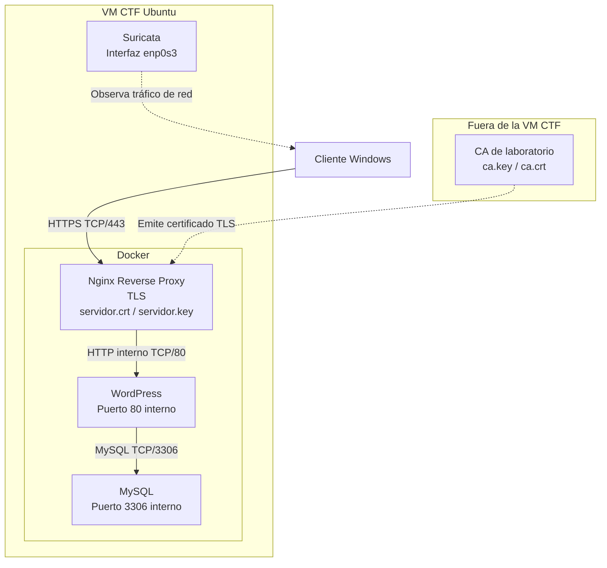

Proyecto final del curso de Seguridad en Sistemas Informaticos (Ironhack) con tematica de Terminator (Skynet) 

Nombre: Ricardo Garcia López 

Proyecto individual

Descripción de la maquina virtual:

S.O: Ubuntu 23.04 LTS (64 bits)
Kernel: Linux 5.15.0
Red: Bridge
IP: ¿?

Tecnologías:
─ SO:           Ubuntu 23.04 (64 bits)
├─ Virtualización: Docker + Docker Compose
├─ Web:          WordPress 6.4
├─ Base Datos:   MySQL 8.0
├─ Acceso:       OpenSSH 8.0 
├─ Seguridad:    Suricata IDS 
└─ Orquestación: 2 Contenedores 


Temática del CTF: "Skynet: Terminator Hunter"

Skynet despierta, 3 mil millones de personas mueren en 2 horas, las máquinas toman el control global, las humanidad se desmorona...
La resistencia ha localizado SKYNET-COMM-WEST-01 un servidor crítico de Skynet que controla el entro de comunicaciones principal en una instalación militar subterránea, si cae 
la humanidad tiene oportunidad de ganar.

Arquitectura:


                 "CLIENT"
                    │
                    ▼
              Ubuntu Server
                    │
       ┌────────────┼────────────┐
       │            │            │
      SSH       Suricata       Docker
                                  │
                         ┌────────┴────────┐
                         │                 │
                        WEB               DB

                        
    Conexion por:
        │
        ├── SSH :22
        │
        └── HTTP :80
                 │
                 ▼
         ┌─────────────────┐
         │    WordPress    │
         │                 │
         │ skynet_public   │
         │ skynet_private  │
         └────────┬────────┘
                  │
                  │ skynet_private
                  ▼
         ┌─────────────────┐
         │      MySQL      │
         │                 │
         │ skynet_private  │
         └────────┬────────┘
                  │
          skynet_mysql_data


                       "Networks"
                            │
                            │ HTTP :80
                            ▼
                 ┌─────────────────────┐
                 │      WordPress      │
                 │                     │
                 │  skynet_public      │
                 │  skynet_private     │
                 └─────────┬───────────┘
                           │
                           │ skynet_private
                           ▼
                 ┌─────────────────────┐
                 │        MySQL        │
                 │                     │
                 │  skynet_private     │
                 └─────────────────────┘

## Tabla informativa

| Servicio  | Puerto   | Expuesto | Función                    |
|-----------|----------|----------|----------------------------|
| SSH       | 22/TCP   | Sí       | Acceso remoto al servidor  |
| WordPress | 80/TCP   | Sí       | Aplicación web             |
| MySQL     | 3306/TCP | No       | Base de datos interna      |


## Servicios y puertos

| Servicio        | Tecnología            | Puerto   | Expuesto | Función |
|----------------|-----------------------|----------|----------|---------|
| SSH            | OpenSSH               | 22/TCP   | Sí       | Acceso remoto y administración del servidor |
| Web            | WordPress + Apache    | 80/TCP   | Sí       | Aplicación web accesible por los usuarios |
| Base de datos  | MySQL 8.0             | 3306/TCP | No       | Persistencia de datos de WordPress |
| Docker         | Docker Engine         | N/A      | No       | Ejecución y gestión de los contenedores |
| IDS            | Suricata              | N/A      | No       | Monitorización y detección de tráfico de red |


### Interfaz de red

La interfaz principal utilizada por Suricata es:

```text
enp0s3


## Línea base de detección

| Acción | Fuente | Detectada / registrada | Información obtenida |
|---|---|---|---|
| SSH correcto | `journalctl -u ssh` / `/var/log/auth.log` | Sí | Fecha/hora, IP origen, usuario y autenticación aceptada |
| SSH incorrecto | `journalctl -u ssh` / `/var/log/auth.log` | Sí | Fecha/hora, IP origen, usuario e intento de autenticación fallido |
| Web válida | `docker logs skynet_wordpress` | Sí | IP origen, fecha/hora, método HTTP, URL y código de respuesta |
| Web 404 | `docker logs skynet_wordpress` | Sí | IP origen, fecha/hora, URL solicitada y código HTTP `404` |
| Docker | `docker logs` / `docker ps` | Sí | Estado de contenedores, inicialización, actividad y errores |
| Ping | Suricata / `tcpdump` / `stats.log` | Parcial | Tráfico ICMP capturado y decodificado; alerta personalizada pendiente de validación |
| Nmap | Suricata / logs del sistema y servicios | Pendiente | Pendiente de realizar y documentar una prueba real |
```
### Evidencia real de escaneo Nmap

Se realizó un escaneo real desde una máquina Kali contra el servidor Ubuntu utilizando Nmap.

Ejemplo de prueba realizada:

`nmap -Pn -sT -p 22,80 <IP_DEL_SERVIDOR>`

Suricata detectó los paquetes TCP SYN generados durante el escaneo mediante la regla local:

`alert tcp any any -> $HOME_NET any (msg:"SKYNET - TCP SYN DETECTADO"; flags:S; sid:1000002; rev:1;)`

Las alertas fueron verificadas mediante:

`sudo grep 'SKYNET' /var/log/suricata/fast.log`

y:

`sudo grep 'SKYNET' /var/log/suricata/eve.json`

La actividad quedó registrada correctamente en:

- `/var/log/suricata/fast.log`
- `/var/log/suricata/eve.json`

Los eventos permiten identificar información como:

- fecha y hora
- IP de origen
- IP de destino
- protocolo TCP
- puerto origen
- puerto destino
- SID de la regla
- mensaje de la alerta

La regla TCP utiliza el SID `1000002`.

Esta prueba demuestra que Suricata puede detectar y registrar tráfico TCP SYN generado durante un escaneo real de puertos con Nmap.

## Estado de las pruebas de Suricata

| Prueba | Resultado |
|---|---|
| Instalación de Suricata | Completada |
| Configuración de `suricata.yaml` | Completada |
| Configuración de `local.rules` | Completada |
| Validación con `suricata -T` | Correcta |
| Servicio Suricata | Activo |
| Detección ICMP / Ping | Correcta |
| Alerta ICMP en `fast.log` | Correcta |
| Alerta ICMP en `eve.json` | Correcta |
| Escaneo real con Nmap | Completado |
| Detección TCP SYN | Correcta |
| Alerta TCP en `fast.log` | Correcta |
| Alerta TCP en `eve.json` | Correcta |

## Fase 1 - Arquitectura HTTPS



### Redes Docker

- `skynet_public`: Nginx y WordPress.
- `skynet_private`: WordPress y MySQL.

### Uso de TLS

TLS se utiliza entre el cliente y Nginx mediante HTTPS en el puerto 443. Nginx actúa como punto de terminación TLS y gestiona el certificado y la clave privada del servidor.

La comunicación entre Nginx y WordPress permanece dentro de Docker mediante HTTP. La comunicación entre WordPress y MySQL también es interna y utiliza el puerto 3306.

La autoridad certificadora se mantiene fuera de la VM CTF. La clave privada de la CA no forma parte de la máquina vulnerable.

Suricata permanece instalado directamente en Ubuntu y monitoriza el tráfico de la interfaz de red del servidor.

### Justificación de HTTPS y TLS

HTTP transmite la información sin cifrado, por lo que el contenido de las comunicaciones puede observarse si se captura el tráfico.

HTTPS añade TLS a la comunicación HTTP, proporcionando cifrado durante el tránsito y permitiendo autenticar al servidor mediante un certificado digital.

En esta arquitectura se utiliza HTTPS entre el cliente y Nginx. Nginx realiza la terminación TLS y utiliza el certificado emitido por la CA de laboratorio.

Las comunicaciones entre Nginx, WordPress y MySQL permanecen dentro de las redes Docker internas.

Se utilizan TLS 1.2 y TLS 1.3, manteniendo deshabilitadas las versiones antiguas del protocolo.


## Fase 2 - Construcción de la PKI con OpenSSL

Se ha creado una infraestructura PKI de laboratorio utilizando OpenSSL.

La autoridad certificadora se mantiene fuera de la máquina virtual CTF. La clave privada `ca.key` se encuentra cifrada y no se ha transferido al servidor Ubuntu.

La CA raíz se ha generado como certificado autofirmado y se ha comprobado que incluye:

- `CA:TRUE`
- `pathlen:0`
- permisos de firma de certificados y CRL
- algoritmo SHA-256 con RSA

En el servidor Ubuntu se ha generado la clave privada `servidor.key` y la solicitud de certificado `servidor.csr`.

La CSR utiliza como nombre del servidor:

`SkynetFinal`

y contiene el SAN:

`DNS:SkynetFinal`

La firma de la CSR se verificó correctamente mediante OpenSSL.

El certificado `servidor.crt` fue firmado por la CA de laboratorio y contiene:

- `CA:FALSE`
- `serverAuth`
- `DNS:SkynetFinal`

Se realizaron las siguientes comprobaciones:

- Validación correcta de la cadena utilizando `ca.crt`.
- Validación correcta del nombre `SkynetFinal`.
- Fallo de validación utilizando un nombre de servidor incorrecto.
- Fallo de validación al no proporcionar la CA de confianza.
- Comprobación de las fechas de validez.
- Comprobación de correspondencia entre `servidor.key` y `servidor.crt`.

La instalación final en Ubuntu utiliza:

- `/etc/ssl/private/servidor.key`
- `/etc/ssl/certs/servidor.crt`
- `/etc/ssl/certs/ca.crt`

La clave privada del servidor tiene permisos `600` y los certificados permisos `644`.

La validación final se realizó con:

`openssl verify -CAfile /etc/ssl/certs/ca.crt -purpose sslserver -verify_hostname SkynetFinal /etc/ssl/certs/servidor.crt`

Resultado:

`/etc/ssl/certs/servidor.crt: OK`

### Interpretación del certificado del servidor

El certificado `servidor.crt` fue revisado mediante OpenSSL para comprobar sus campos principales.

- **Subject:** identifica al servidor certificado. El nombre común es `SkynetFinal`.
- **Issuer:** identifica a la autoridad que emitió el certificado. En este caso es `Skynet Lab Root CA`.
- **Validez:** el certificado es válido desde `25 Oct 2026 09:59:11 GMT` hasta `27 Jan 2029 09:59:11 GMT`.
- **Subject Alternative Name (SAN):** contiene `DNS:SkynetFinal`, que es el nombre utilizado para validar la identidad del servidor.
- **Clave pública:** utiliza RSA con una longitud de 4096 bits.
- **Algoritmo de firma:** `sha256WithRSAEncryption`.

Estos campos permiten comprobar la identidad del servidor, quién ha emitido el certificado, durante qué periodo es válido y qué algoritmos criptográficos utiliza.

## Fase 3 - HTTPS con Nginx Reverse Proxy y Docker

Se ha añadido Nginx como reverse proxy delante de WordPress.

Nginx es el único servicio web que publica puertos hacia el host:

- `80/tcp` para HTTP.
- `443/tcp` para HTTPS.

WordPress mantiene el puerto 80 únicamente dentro de Docker y MySQL no publica el puerto 3306 hacia el host.

### Redes Docker

La distribución de servicios es:

- `skynet_public`: Nginx y WordPress.
- `skynet_private`: WordPress y MySQL.

Nginx recibe las conexiones del cliente y reenvía las peticiones internamente hacia WordPress.

### TLS

Nginx utiliza:

- `/etc/ssl/certs/servidor.crt`
- `/etc/ssl/private/servidor.key`

Los archivos se montan dentro del contenedor Nginx en modo solo lectura.

La configuración de Nginx se validó mediante:

`nginx -t`

con resultado satisfactorio.

El certificado presentado por el servicio HTTPS corresponde a `SkynetFinal` y ha sido emitido por `Skynet Lab Root CA`.

### Funcionamiento de la aplicación

Se comprobó que WordPress mantiene correctamente la conexión con MySQL:

`DB_OK`

También se comprobó el acceso real a WordPress mediante HTTPS:

`https://SkynetFinal/wp-login.php`

Resultado:

`HTTP 200`

La configuración de Docker Compose se validó mediante `docker compose config --quiet`, sin obtener errores de sintaxis o configuración.


### Validación desde cliente

La conexión HTTPS se comprobó desde Windows utilizando la CA de laboratorio y el nombre correcto del servidor.

Resultado:

`HTTP 200`

No se utilizó `curl -k`.

Para Windows con Schannel se utilizó `--ssl-no-revoke`, ya que la CA de laboratorio no dispone de servicio de comprobación de revocación.

### Redirección HTTP a HTTPS

Las peticiones realizadas mediante HTTP son redirigidas a HTTPS.

Ejemplo:

`http://SkynetFinal/wp-login.php`

Resultado:

`HTTP/1.1 301 Moved Permanently`

Redirección:

`https://SkynetFinal/wp-login.php`


## Fase 4 - Validación TLS y monitorización

Se realizaron pruebas sobre el servicio HTTPS para comprobar la configuración TLS y la visibilidad del tráfico desde Suricata.

### Línea base HTTPS

La conexión HTTPS fue validada mediante OpenSSL utilizando la CA de laboratorio y el nombre `SkynetFinal`.

La negociación obtenida fue:

- Protocolo: TLS 1.3
- Cipher suite: `TLS_AES_256_GCM_SHA384`
- Certificado presentado: `CN=SkynetFinal`
- Verificación del certificado: `OK`
- Nombre verificado: `SkynetFinal`

### Protocolos TLS

La configuración activa de Nginx permite:

`TLSv1.2 TLSv1.3`

Se realizaron pruebas independientes:

- TLS 1.2: conexión correcta.
- TLS 1.3: conexión correcta.
- TLS 1.1: conexión rechazada.

Los protocolos TLS obsoletos no se encuentran habilitados.

### Comparación HTTP y HTTPS

Se realizaron capturas sobre la interfaz `enp0s3`.

En tráfico HTTP por el puerto 80 fue posible observar en claro información de aplicación como:

`HEAD /wp-login.php?fase4=1 HTTP/1.1`

En la prueba equivalente sobre HTTPS por el puerto 443 se observó tráfico TLS cifrado, sin poder visualizar en claro la ruta solicitada.

Suricata puede observar información de red y TLS como IP origen, IP destino, puertos, versión TLS y SNI, pero no descifra por sí solo las rutas HTTP transportadas dentro de HTTPS.

Nginx sí dispone de la petición HTTP completa después de realizar la terminación TLS.

### Regla Suricata para HTTPS

Se añadió la siguiente regla local:

`alert tls any any -> $HOME_NET 443 (msg:"SKYNET - HTTPS TLS CONNECTION"; flow:established,to_server; sid:1000004; rev:1;)`

La configuración fue validada mediante:

`suricata -T -c /etc/suricata/suricata.yaml`

Resultado:

`Configuration provided was successfully loaded`

Se realizó posteriormente una conexión HTTPS real y se generaron alertas con SID `1000004` tanto en:

- `/var/log/suricata/fast.log`
- `/var/log/suricata/eve.json`

La regla identifica una conexión TLS hacia el puerto 443. Esta alerta no implica por sí misma que exista un ataque.

### Correlación Suricata y Nginx

Se utilizó la petición:

`GET /wp-login.php?suricata=1`

Nginx registró:

- Cliente: `192.168.1.13`
- Fecha/hora: `25/Oct/2026 11:00:27`
- Petición: `GET /wp-login.php?suricata=1`
- Resultado: `HTTP 200`

Suricata registró en el mismo instante:

- Origen: `192.168.1.13`
- Destino: `192.168.1.134:443`
- SID: `1000004`
- SNI: `skynetfinal`
- TLS: `1.3`

En esta prueba las dos fuentes mantuvieron la misma IP del cliente.

### Tabla de correlación Nginx y Suricata

Se correlacionó la misma petición HTTPS utilizando los registros de Nginx y Suricata.

| Dato | Nginx | Suricata |
|---|---|---|
| Fecha/hora | 25/Oct/2026 11:00:27 +0000 | 2026-10-25 11:00:27 +0000 |
| IP cliente | 192.168.1.13 | 192.168.1.13 |
| IP servidor | Servicio Nginx | 192.168.1.134 |
| Puerto destino | 443 mediante HTTPS | 443 |
| Petición | `GET /wp-login.php?suricata=1` | No visible en claro |
| Resultado HTTP | 200 | No visible |
| Protocolo | HTTPS | TLS 1.3 |
| SNI | `SkynetFinal` | `skynetfinal` |
| Regla / SID | No aplica | `1000004` - `SKYNET - HTTPS TLS CONNECTION` |

Ambas fuentes registran la misma conexión y mantienen la IP real del cliente `192.168.1.13`.

Nginx puede registrar la ruta solicitada y el código HTTP porque realiza la terminación TLS. Suricata observa la conexión cifrada antes de esa terminación y puede identificar datos como IPs, puertos, versión TLS y SNI, pero no puede ver por sí solo la ruta HTTPS.

Una conexión o un paquete SYN dirigido al puerto 443 no implica por sí mismo que exista un ataque. La regla `1000004` únicamente genera una alerta para registrar una conexión TLS hacia el servicio HTTPS.


### Comprobación final

Se comprobó finalmente que:

- MySQL permanece activo.
- WordPress mantiene conexión con la base de datos: `DB_OK`.
- Nginx supera `nginx -t`.
- Suricata permanece activo.
- WordPress responde mediante HTTPS con `HTTP 200`.


## Evidencias

Las siguientes capturas corresponden a las comprobaciones reales realizadas durante la implementación y validación del proyecto.

### Fase 1 - Arquitectura

La evidencia de esta fase corresponde al diagrama de arquitectura incluido en el propio README, donde se representa Nginx como reverse proxy, la terminación TLS, las redes Docker, WordPress, MySQL, la CA externa y Suricata.

### Fase 2 - PKI con OpenSSL

- [F2.2 - CA raíz y validación](evidencias/F2_2_CA_raiz.png)
- [F2.3 - CSR, SAN y verificación](evidencias/F2_3_CSR_SAN_verificacion.png)
- [F2.4 - Certificado del servidor](evidencias/F2_4_certificado_servidor.png)
- [F2.5 - Verificación del certificado](evidencias/F2_5_verificacion_certificado.png)
- [F2.6 - Instalación, permisos y validación](evidencias/F2_6_permisos_validacion.png)
- [F2.7 - Interpretación del certificado](evidencias/F2_7_interpretacion_certificado.png)

### Fase 3 - HTTPS con Nginx Reverse Proxy y Docker

- [F3.1 / F3.2 - Docker Compose, Nginx y validación](evidencias/F3_1_2_compose_nginx.png)
- [F3.1 - Validación de Docker Compose](evidencias/F3_1_validacion_compose.png)
- [F3.2 / F3.3 - Certificado, puertos y redes Docker](evidencias/F3_2_3_certificado_puertos_redes.png)
- [F3.4 - WordPress, MySQL y HTTPS](evidencias/F3_4_wordpress_mysql_https.png)
- [F3.5 / F3.6 - HTTPS desde cliente y redirección HTTP a HTTPS](evidencias/F3_5_6_https_redireccion.png)

### Fase 4 - Validación TLS y monitorización

- [F4.1 - Línea base TLS](evidencias/F4_1_linea_base_tls.png)
- [F4.2 - Configuración TLS de Nginx](evidencias/F4_2_configuracion_nginx_tls.png)
- [F4.2 - Pruebas TLS 1.2, TLS 1.3 e intento TLS 1.1 desde cliente](evidencias/F4_2_protocolos_tls.png)
- [F4.2 - Enumeración de protocolos ofrecidos por el servidor](evidencias/F4_2_nmap_protocolos_servidor.png)
- [F4.3 - Tráfico HTTP visible en claro](evidencias/F4_3_http_claro.png)
- [F4.3 - Tráfico HTTPS cifrado](evidencias/F4_3_https_cifrado.png)
- [F4.4 - Alerta HTTPS real en Suricata](evidencias/F4_4_suricata_alerta.png)
- [F4.4 - Regla propia y validación de Suricata](evidencias/F4_4_suricata_regla_validacion.png)
- [F4.5 - Correlación entre Nginx y Suricata](evidencias/F4_5_correlacion_nginx_suricata.png)
- [F4.6 - Comprobación final del entorno](evidencias/F4_6_comprobacion_final.png)
